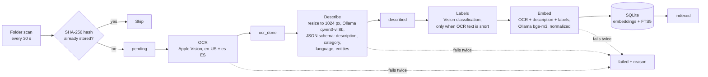
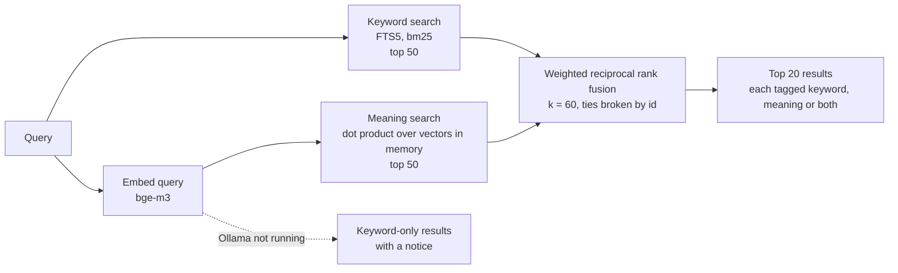

# FindIt

FindIt is a macOS app which finds a screenshot on your Mac from a description you give it, in English or Spanish, without anything leaving your computer.

## Why I built it
Generally I have a really messy computer and a lot of screenshots which I have to scan for, so it seemed like a great way to leverage local running models to help with this problem especially as I tend to think in both english and spanish depending on the image 

## How it works

FindIt looks at a folder. Each new screenshot is read with Apple Vision, described by a local vision model, and stored twice: as text for keyword search and as a vector for meaning search. A search runs both and merges the two rankings in an attempt of a more accurate retrieval

### Indexing pipeline

Every screenshot moves through saved statuses, so indexing picks up where it left off after a quit.

### Search

## Results

Search was scored against a private set of 250 queries over my own screenshots. Each query has a type (exact text, paraphrase, visual, or multi-answer) and a language (English or Spanish). The screenshots and queries stay private, so only aggregate numbers appear here.

- **hit@5**: a relevant screenshot is in the top 5.
- **recall@5**: the share of relevant screenshots in the top 5 (multi-answer queries only).
- **MRR@20**: the mean of 1 / rank of the first relevant result in the top 20.

### Baseline and search ablation (all 250 queries)

| Search | hit@5 | recall@5 (multi) | MRR@20 | median ms | p95 ms |
|---|---|---|---|---|---|
| Keyword only | 0.680 | 0.591 | 0.591 | 0.4 | 0.7 |
| Meaning only | 0.840 | 0.817 | 0.710 | 14.6 | 18.9 |
| Fused, equal weights (baseline) | 0.812 | 0.769 | 0.684 | 15.7 | 20.6 |

By query type, hit@5:

| Query type | n | Keyword only | Meaning only | Fused baseline |
|---|---|---|---|---|
| Exact text | 62 | 0.984 | 0.935 | 0.968 |
| Paraphrase | 42 | 0.810 | 0.952 | 0.905 |
| Visual | 123 | 0.480 | 0.732 | 0.683 |
| Multi-answer | 23 | 0.696 | 0.957 | 0.913 |
| Visual, Spanish | 21 | 0.048 | 0.667 | 0.524 |

### Tuning runs (dev split: odd-numbered queries, n = 125)

| Keyword weight | Stopwords | hit@5 | recall@5 (multi) | MRR@20 |
|---|---|---|---|---|
| 1.0 | kept | 0.848 | 0.833 | 0.743 |
| 1.0 | removed | 0.880 | 0.842 | 0.748 |
| 0.5 | kept | 0.880 | 0.851 | 0.755 |
| 0.5 | removed | 0.880 | 0.851 | 0.755 |
| **0.25** | **kept** | **0.888** | **0.863** | **0.762** |
| 0.25 | removed | 0.872 | 0.863 | 0.762 |
| Meaning only | | 0.856 | 0.815 | 0.758 |

### Final comparison (test split: even-numbered queries, n = 125)

The test split was only scored after tuning was finished, so these numbers weren't used to pick the settings.

| Configuration | hit@5 | recall@5 (multi) | MRR@20 |
|---|---|---|---|
| Baseline: fused, weight 1.0 | 0.776 | 0.669 | 0.625 |
| Shipped: fused, weight 0.25 | 0.800 | 0.765 | 0.658 |
| Meaning only | 0.824 | 0.820 | 0.663 |

### Embedding model (test split, shipped settings)

| Embedder | All | English | Spanish | Spanish visual |
|---|---|---|---|---|
| bge-m3 (shipped) | 0.800 | 0.779 | 0.846 | 0.667 |
| nomic-embed-text | 0.728 | 0.779 | 0.615 | 0.000 |

## What the eval showed

- **Fusion:** With equal weights the fused search (0.812 hit@5) scored below meaning-only search (0.840). Keyword search matches any word of the query, so common words like "de" or "the" match OCR text in hundreds of unrelated screenshots, and that noise got an equal vote. Lowering the keyword weight to 0.25 fixed it: on the held-out test split, hit@5 rose from 0.776 to 0.800 and MRR from 0.625 to 0.658. Against meaning-only, tuned fusion won on dev (0.888 vs 0.856) but lost on test (0.800 vs 0.824). Across all 250 queries that's 211 vs 210, a tie. I shipped fusion anyway, because it's consistently better on exact-text searches (0.963 vs 0.926 on test) and still returns keyword results when Ollama isn't running.
- **Spanish visual queries:** Descriptions are always written in English, so a Spanish visual query has to match across languages. Keyword search found only 1 of 21 (0.048), and with equal weights its noise pulled fused search down to 0.524, against 0.667 for meaning-only. Switching from bge-m3 to nomic-embed-text left English unchanged (0.779 for both) but dropped Spanish visual queries to 0 of 12 on the test split. A six-sentence toy test predicted this before the full run: bge-m3 scored an English and a Spanish sentence with the same meaning at 0.91, nomic at 0.52.
- **Query type mix:** Overall, Spanish queries scored higher than English ones (0.821 vs 0.807 at baseline). But within each type, English wins: exact text 1.000 vs 0.939, visual 0.716 vs 0.524. The overall gap comes from the mix: 68% of Spanish queries are exact text or paraphrase, the easy types, while 61% of English queries are visual, the hardest. Comparing within groups avoids a wrong conclusion that it performs better in spanish when its clearly not the case

## How it was evaluated

- **Golden set:** 250 queries, one per screenshot in a private corpus of 250. Each query was written from memory: look at the screenshot, close it, wait, then write what I'd actually type a month later. Queries were checked so that every correct answer is listed, and multi-answer queries list all of them.
- **Matching by content:** results count as correct when the file's hash matches, so duplicate files can't cause false misses.
- **Predictions first:** expected behaviour were written down before the first run.
- **Dev/test split:** settings were tuned only on odd-numbered queries, then scored once on even-numbered ones.
- **Sample size:** one query moves the overall score by 0.4 points, and a split's score by 0.8. Small groups like Spanish visual (21 queries) are rough signals, not precise numbers.
- **Methodology credit:** the unique-answer task design, outcome-based scoring and single-factor ablations are adapted from τ-bench (Yao et al., 2024) and τ-Voice (Ray et al., 2026) from Sierra's Ai research team.

## Design decisions

**Descriptions saved separately from embeddings** The slow part, describing an image with a vision model, is saved on its own before the fast part (labels, embedding, keyword index). So switching the embedding model only reruns the fast phase over descriptions that already exist, instead of running the vision model over every screenshot again. The eval tool relies on this to compare embedders on one fixed set of descriptions.

**Resumable queue** Each step saves its results and the next status in the database, so a quit or crash resumes from the last finished step. A failed step is retried once, then the screenshot is marked failed with a reason, and the queue moves on. Only one indexing pass runs at a time. That opened a race: a new screenshot could be added just after the running pass found nothing left to do, while the second `run()` call returned early because a pass was "already running". The screenshot then sat unindexed until the next file arrived. The fix is a "more work requested" flag. Adding work or calling `run()` during a pass sets it, and the pass checks it once more before stopping.

**Search with weighted fusion.** Keyword search is precise for words that appear on screen. Meaning search finds paraphrases, visual descriptions and the other language. Reciprocal rank fusion merges the two by rank, so their very different score scales don't need calibrating against each other. A weight per list lets the eval decide how much keywords should count; the shipped app uses 0.25.

**One embedding per model.** Vectors are stored with the model name, keyed by screenshot and model. Trying a new embedder adds vectors next to the old ones instead of overwriting them, and search only compares vectors from the same model. Models that need task prefixes, such as `nomic-embed-text`, get them from one shared function, so indexing and search always agree.

**Everything local.** OCR and labels use Apple Vision on the device. Descriptions and embeddings come from Ollama on `localhost:11434`, which is the only network address FindIt talks to.

## Performance

On my MacBook Pro with an M4 and 24 GB of memory:

- **Indexing:** about 13 to 24 seconds per screenshot with qwen3-vl:8b, almost all of it describing. It rose to about 30 seconds as the laptop heated up and throttled. All 250 screenshots indexed with zero failures, run in batches.
- **Switching embedders:** re-embedding all 250 screenshots took 7 seconds, because descriptions are saved separately and reused.
- **Search:** a median of 16 ms per query. Keyword search alone takes 0.4 ms; the rest is embedding the query.

## Limitations and future work

- **Vision model comparison.** All results use `qwen3-vl:8b`. `gemma4:e4b` is supported but hasn't been compared on the golden set yet.
- **Image size.** Screenshots are shrunk so the longest side is about 1024 px before describing. That keeps the vision model fast, but small text on large or high-resolution screenshots could be lost
- **pass^k.** The describer isn't deterministic, so the same screenshot can get a different description on another run. Measuring pass^k (whether a query still succeeds across k independent indexing runs) would show how stable the results are.
- **Signal ablation.** The searchable text joins OCR, the description and the labels. Removing each one in turn would show which signal does the work.
- **Renamed files.** Screenshots are recognized by content hash, so a renamed or moved file isn't indexed again, but its stored path goes out of date and the result can't open. The folder scan should update paths for known hashes.
- **Search by date.** FindIt only stores when a screenshot was added to the index, not when it was taken, and dates can't be searched. Queries like "last week" or "in March" would need the capture date from the file plus date parsing and a filter.

## Install

**Requirements:** macOS 15 or later, and [Ollama](https://ollama.com) installed and running. Apple silicon is recommended for the vision model.

1. Install Ollama from [ollama.com](https://ollama.com) and open it once, so it's running in the menu bar.
2. Download `FindIt.dmg` 
3. Open FindIt from Applications. It isn't signed with an Apple Developer ID or notarized, so the first time macOS blocks it.
4. On first launch, FindIt checks that Ollama is running and offers to download the models it needs (`qwen3-vl:8b` and `bge-m3`, around 7GB).
5. Choose the folder it will reference, for example the folder your screenshots are saved to. Indexing starts in the background.